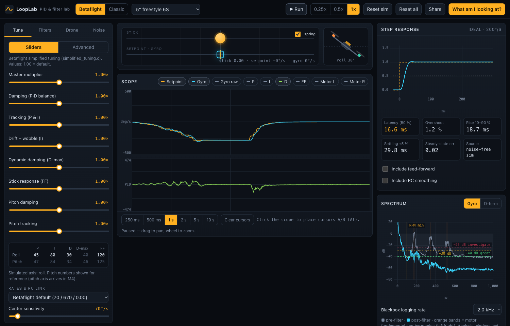
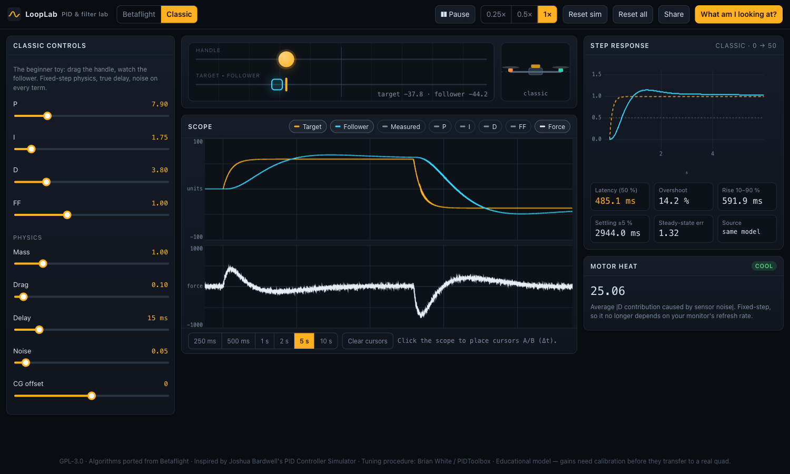
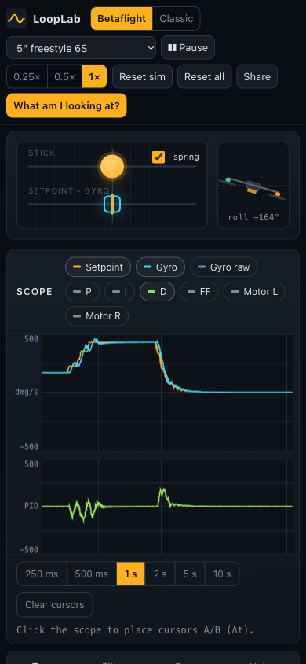
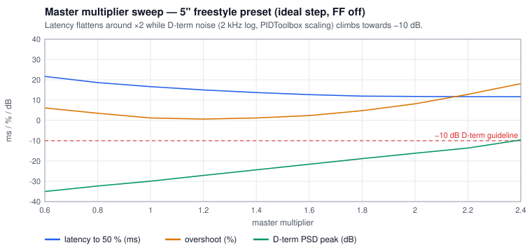

# LoopLab

**A Betaflight-faithful PID and filter simulator that runs in the browser.** Drag a stick and see a virtual quad's
rate loop react. Look at the spectrum and the step response, and work through the
[Bardwell × Brian White masterclass](https://www.youtube.com/watch?v=FsJNHI2HWlg) lessons before you touch a real quad.

**Live demo:** _coming soon (GitHub Pages; the `deploy.yml` workflow publishes `main`)_



<p>
  
  
</p>

## What it is

The simulator models the actual Betaflight control pipeline on one axis (roll):

```
stick → RC link (packet rate) → ACTUAL rates → RC smoothing (PT3) → PID (P, I + iterm_relax, D on measurement, FF)
      → mixer (airmode-like) → motors (lag, idle, saturation) → rigid body (inertia from a mass model)
      → gyro + motor-harmonic noise → gyro LPF2 → RPM notches → gyro LPF1 → back to the PID
```

The algorithms are ported from Betaflight (`pid.c`, `rc.c`, `filter.c`, `rpm_filter.c`, `simplified_tuning.c`,
betaflight@f97bdbc), and every port cites its source file and function. The simulation is deterministic and does not
depend on frame rate. The same seed and the same inputs give bitwise-identical output on 60, 144 and 240 Hz displays.

## Features (v1 / M3)

- **Betaflight mode:** simplified-tuning sliders (master, damping, tracking, drift–wobble, D-max, stick response,
  pitch damping/tracking) that compute the exact firmware integers, and an Advanced tab with raw gains.
- **Filters:** gyro LPF1 (dynamic) / LPF2, D-term LPF1 (dynamic) / LPF2 (PT1/PT2/PT3/SVF) and the RPM filter
  (harmonics, min frequency, fade, Q). A group-delay readout shows each change.
- **Noise:** motor fundamental plus 2nd/3rd harmonics, which follow RPM. Also a balance knob, an electrical noise floor
  and a frame resonance. A CG offset splits the left and right motors into two peak clusters.
- **Analysis:** an ideal step response with latency to 50 % (PIDToolbox-style), overshoot, rise, settling and SSE,
  where you can switch FF and RC smoothing on or off. A spectrum of the pre-filter gyro, post-filter gyro and
  D-term in the PIDToolbox (PSSpec2d) convention, at a selectable Blackbox logging rate, with the masterclass
  reference lines. A canvas scope with cursors and Δt.
- **Motor temperature:** a qualitative thermal model (D noise and aggressive FF heat the motors).
- **Presets:** 1S whoop, 5" freestyle 6S, 7" long-range 6S with a GoPro. Rates: Betaflight default, "my rates",
  linear tuning rates. RC-link packet rate and flight style.
- **Classic mode:** a beginner-friendly handle-and-follower toy. It uses a fixed step, a correct delay, and noise on
  every term.
- Shareable URL state, a mobile layout down to about 380 px, and a "What am I looking at?" help drawer.

## Masterclass lessons you can try

1. **Hover → spectrum.** Peaks sit on the motor fundamental and harmonics. A floor below −40 dB is great; above
   −30/−25 dB, investigate.
2. **RPM minimum.** Set it 25–30 Hz below the lowest hover motor frequency. Turn the RPM filter off and watch the
   motors heat up.
3. **Filter delay vs noise.** Lower the filter multipliers and you get more delay and lower stable gains. Don't
   over-filter; when in doubt, filter D-term rather than gyro.
4. **Damping sweep, 0.6 → 1.4,** with linear rates and FF = 0. The 7" preset starts with visible overshoot.
5. **Master multiplier** in 0.2 steps. Latency flattens while D-term noise climbs towards −10 dB:

   

6. **I ≈ 1.0, FF 0.5–1.0.** FF cuts latency, but with snappy inputs it heats the 7" preset's motors.

## How it differs from the original simulator, and why

LoopLab was inspired by Joshua Bardwell's [PID Controller Simulator](https://www.fpvknowitall.com/pid-controller-simulator/).
The original has no license, so **no code or styling was reused**: this is a new engine written from scratch. While
building it we found two issues in the original. Its physics depends on the monitor refresh rate, and its delay buffer
is wiped while the setpoint moves, which understates "delay + high P = runaway" (≈ 2.7× smaller oscillation in our
emulation, `npm run findings`). Both are documented
respectfully, with reproduction steps and minimal fixes, in [docs/FINDINGS.md](docs/FINDINGS.md). Classic mode keeps
the original's pedagogy and fixes both.

## Limitations

- This is an educational model of one axis, so **absolute gains transfer to a real quad only after calibration**
  (system identification is planned for M6).
- **Preset parameters are not measurements.** Values such as the 7" motor time constant (32 ms), the noise amplitudes
  and the transport delays were chosen so the masterclass lessons are visible. For example, the damping sweep removes
  most of the 7" overshoot, and the default 5" noise floor sits at −40 dB. They are plausible for each class of craft
  but do not describe any particular build.
- Not yet modelled: D-max, anti-gravity, TPA, the dynamic notch, battery sag and the pitch axis (M4).
- The spectrum follows the PIDToolbox convention (Brian White's `PSSpec2d`: Hann, |Y|²/(fs·N), one-sided) on a
  Blackbox-decimated stream (1.6 / 2 / 3.2 / 4 kHz, default 2 kHz). The model's noise is calibrated against the
  masterclass guidelines rather than a real log, so a real quad may read differently (see
  [docs/MODEL.md §9a](docs/MODEL.md)).
- Equations, parameters and sources are in [docs/MODEL.md](docs/MODEL.md).

## Development

```bash
npm ci
npm run dev          # http://localhost:5173
npm test             # Vitest — engine, filters, PID, sliders, noise, stability, render invariance
npm run typecheck && npm run lint
npm run build        # static site in dist/
npm run findings     # regenerate docs/img/*.svg and docs/findings-data.json
```

Requirements: Node ≥ 22.12. Stack: Vite, React 18, TypeScript (strict), Zustand, uPlot and Vitest. The engine
(`src/engine`) is pure TypeScript with no DOM or React. It runs in a Web Worker in the app and in Node for tests and
scripts.

## Roadmap

See [docs/ROADMAP.md](docs/ROADMAP.md). M4 covers the dynamic notch, D-max, anti-gravity, TPA, battery sag, the pitch
axis and Bode plots. M5 adds a wobble-test generator, a deconvolution step response and a guided Masterclass mode.
M6 adds Blackbox import/export and system identification.

## Contributing

Issues and PRs are welcome. Please keep the engine free of DOM and React. Cite the Betaflight file and function for
anything ported, and mark unverified behaviour `TODO(verify)`. Run `npm run typecheck && npm run lint && npm test`
before you push. Commits follow Conventional Commits.

## Credits / NOTICE

- **Joshua Bardwell — PID Controller Simulator** (fpvknowitall.com) provided the inspiration and teaching idea. No code
  was reused.
- **The Betaflight project** (GPL-3.0): the algorithms are referenced or ported from `src/main/flight/pid.c`, `pid.h`,
  `pid_init.c`, `src/main/fc/rc.c`, `src/main/common/filter.c`, `src/main/sensors/gyro.c`,
  `src/main/flight/rpm_filter.c`, `src/main/config/simplified_tuning.c` and `src/main/flight/mixer.c`.
- **Brian White / PIDToolbox** provided the tuning procedure and analysis concepts (latency to 50 %, spectrum reading),
  via the Betaflight PID Tuning Masterclass with Joshua Bardwell. The spectrum scaling follows the convention of his
  `PSSpec2d.m` (Beer-Ware); no code was copied.

## License

[GPL-3.0](LICENSE). This is compatible with porting logic from Betaflight, which is also GPL-3.0.
