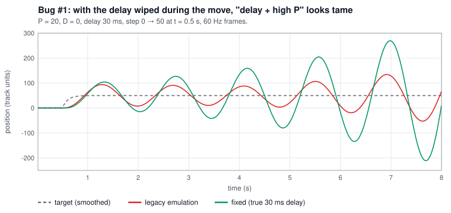
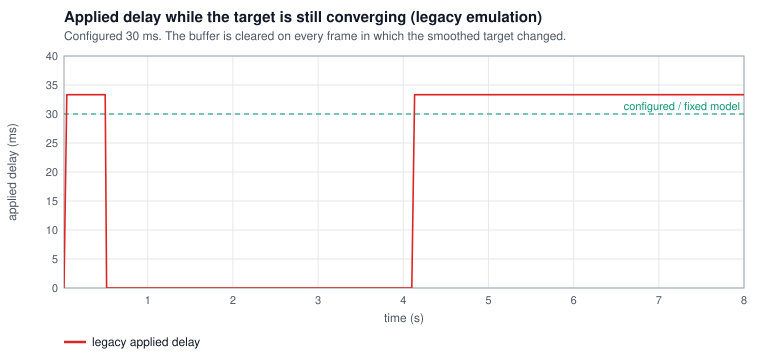
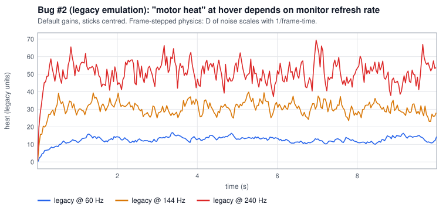
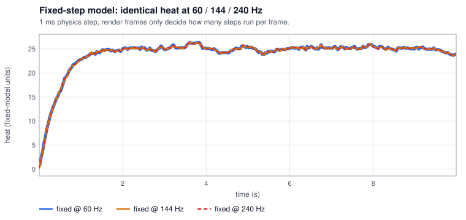

# Findings: Joshua Bardwell's PID Controller Simulator

Joshua Bardwell's [PID Controller Simulator](https://www.fpvknowitall.com/pid-controller-simulator/) is one of the clearest
ways to _feel_ what P, I, D and feed-forward do. LoopLab's Classic mode exists because of it. While building our own
engine (from scratch — the original has no license, so no code or styling was reused) we noticed two issues that make
some of its lessons weaker than intended. They are small to fix. This page documents them so they can be fixed
upstream if useful.

> The page itself says the gains are conceptual and do not relate to real drones. Nothing here changes that; both
> issues are about the toy behaving consistently, not about realism.

## How the original model works (behaviour, as observed)

Each animation frame, with `dt` = frame time (clamped to 50 ms):

```
error    = target − pos
integral = clamp(integral + error·dt, ±200)
gyroD    = (pos + noise − prevNoisyPos) / dt          // noise only enters D
ff       = EMA_0.15(dTarget/dt)                       // per-frame EMA
F        = Kp·error + Ki·integral − Kd·gyroD + Kff·ff
F → time-based delay buffer → a = F/m − drag·v/m + CG → semi-implicit Euler
```

The handle target is itself smoothed with a per-frame EMA (α = 0.15). "Motor heat" is an EMA of the D contribution
caused by noise.

## Bug #1 — the delay buffer is wiped while the setpoint moves

**What happens.** The physics loop lives in a React `useEffect` whose dependency list contains `targetPos`, and the loop
itself calls `setTargetPos(...)` every frame while the smoothed target converges. Each change tears the effect down and
re-creates it, which clears the force/delay buffer and resets the frame timer. Right after a stick move, the configured
delay is therefore barely applied.

**Re-verified on the live page (2026-11-11)** with the reproduction snippet below (headless Chromium, real mouse drag):

| State                     | Effect re-creations per second |
| ------------------------- | ------------------------------ |
| Idle                      | 0                              |
| While dragging the handle | 144, 140                       |
| After release             | 122, 94, then 0                |

So the effect is re-created on every frame while the target moves and for a couple of seconds after release, while the
EMA-smoothed target is still converging. The exact counts depend on the browser's frame rate and on how far the handle
moved.

**Why it matters.** The core lesson "delay + high P = runaway" is understated exactly when the user is interacting.
Our emulation of the mechanism (`LegacyClassicSim`, P = 20, D = 0, delay 30 ms, step at t = 0.5 s, 60 Hz frames):



|                                 | Oscillation amplitude around t = 6 s |
| ------------------------------- | ------------------------------------ |
| Legacy emulation (buffer wiped) | **63**                               |
| Fixed (true 30 ms delay)        | **169** (≈ 2.7×)                     |



**Reproduction snippet** — paste in DevTools on the original page, then drag the handle:

```js
let c = 0;
const oc = cancelAnimationFrame.bind(window);
window.cancelAnimationFrame = (id) => {
  c++;
  return oc(id);
};
setInterval(() => {
  console.log('effect re-creations/s:', c);
  c = 0;
}, 1000);
```

**Minimal fix.** Keep `targetPos` in a ref (or move the loop into a mount-once effect that reads refs), so the loop is
never torn down by its own state updates.

## Bug #2 — physics depends on monitor refresh rate

**What happens.** The integration step equals the display frame time, and the noise-driven D term divides by `dt`.
On a 144 Hz or 240 Hz monitor `dt` is 2.4–4× smaller, so the same noise produces 2.4–4× more D, and "motor heat" rises.
The FF and setpoint EMAs are per-frame too, so their time constants also change with the monitor.

Our emulation, default settings, sticks centred, 10 s:

| Refresh rate | Legacy "motor heat"    | Fixed-step model |
| ------------ | ---------------------- | ---------------- |
| 60 Hz        | 14.6                   | 24.0             |
| 144 Hz       | 30.4                   | 24.0             |
| 240 Hz       | 45.0 (≈ 3.1× of 60 Hz) | 24.0             |




We did not measure this on the live page, because a headless browser does not give a controllable refresh rate. The
emulation above shows the mechanism; its heat units are not the original's. All numbers on this page come from
`npm run findings` (written to `docs/findings-data.json`), except the live re-creation counts in the Bug #1 table.

**Minimal fix.** A fixed-step accumulator:

```js
acc += frameDt;
while (acc >= h) {
  step(h);
  acc -= h;
} // e.g. h = 1 ms
```

and EMA coefficients derived from time constants instead of per-frame constants: `α = 1 − exp(−h/τ)`
(α = 0.15 per frame at 60 fps ≈ τ = 103 ms).

## Smaller observations

- Noise enters only the D term; P and I use the clean position. Real gyro noise affects every term.
- The step-response panel re-simulates at a fixed 240 Hz **without FF and without setpoint smoothing**, so it does not
  match what the live view does.
- The step response is recomputed every frame (2400 steps) and a 3600-element history array is copied every frame, so
  the whole app re-renders at frame rate.
- Rise time is reported 10–90 %; PIDToolbox / Brian White use latency to 50 %.

## What LoopLab's Classic mode does differently

Fixed 1 ms step (`FixedStepClock`), a delay line that always applies exactly the configured delay (spec test 2),
measurement noise on every term, time-constant EMAs, and a step-response panel that runs the _same_ pipeline as the live
view. Render-rate invariance is a unit test (spec test 1). The legacy behaviour is kept only as a dev-only class
(`LegacyClassicSim`) to generate the plots on this page: `npm run findings`.

Thanks to Joshua Bardwell for the simulator and for inviting people to take it in their own direction.
